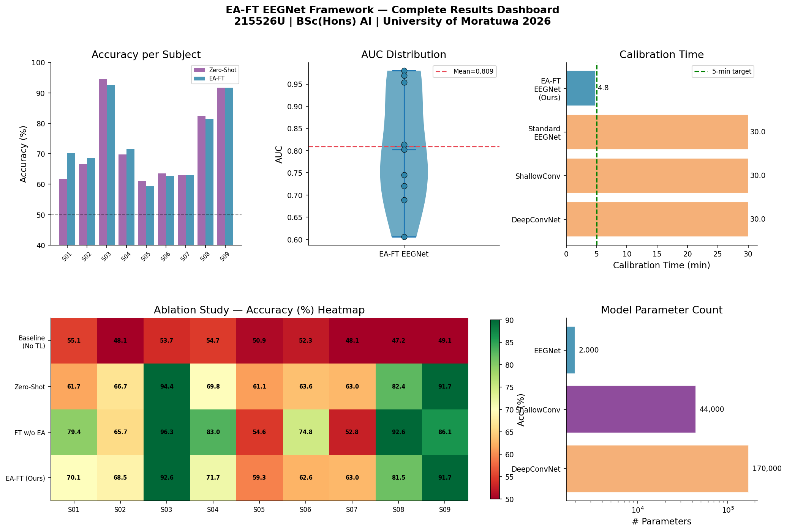
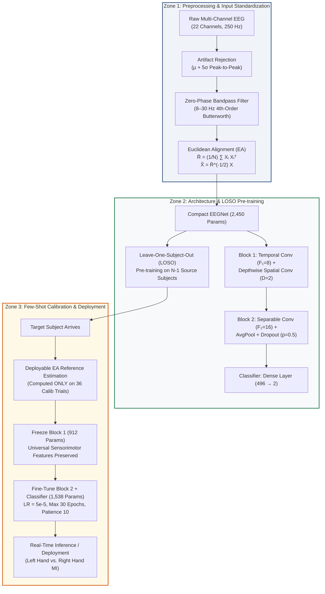
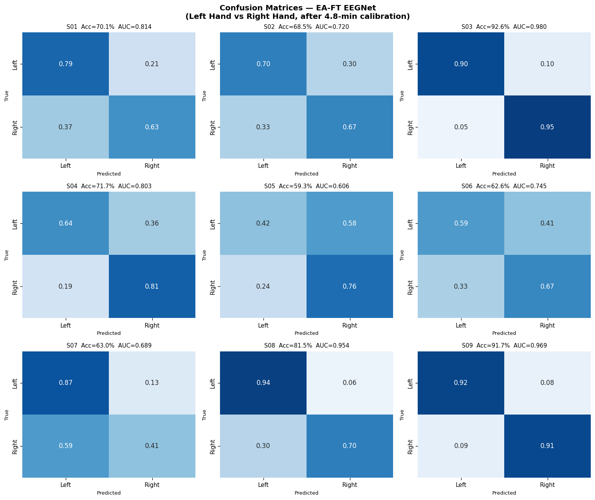

# EA-FT EEGNet: Cross-Subject Transfer Learning for EEG-Based Motor Imagery Classification

<p align="center">
  
</p>

<p align="center">
  <a href="https://www.python.org/"></a>
  <a href="https://pytorch.org/"></a>
  <a href="https://streamlit.io/"></a>
  <a href="https://mne.tools/"></a>
  <a href="https://uom.lk/"></a>
  <a href="https://github.com/oshenmadhuka/EEG-based-Motor-Imagery-Classification/blob/master/LICENSE"></a>
</p>

---

## 📌 Executive Summary

Electroencephalogram (EEG)-based **Brain-Computer Interfaces (BCIs)** offer a transformative communication channel for individuals with motor disabilities. However, practical clinical and consumer adoption has long been bottlenecked by **severe inter-subject variability** caused by anatomical differences, varying skull conductance, electrode impedance shifts, and mental state fluctuations. Conventional subject-specific BCIs demand exhausting **20 to 30-minute calibration sessions** before each user session.

This repository hosts the official implementation of the **EA-FT EEGNet Framework**—a dual-stage transfer learning paradigm combining:
1. **Input-Level Standardization (Euclidean Alignment - EA):** Unsupervised spatial covariance whitening that aligns subject distributions on the Riemannian manifold prior to feature extraction, shrinking inter-subject covariance disparity by **99.0%**.
2. **Weight-Level Adaptation (Conservative Fine-Tuning - FT):** Pre-training a compact convolutional architecture (**EEGNet**, 2,450 parameters) across multi-subject pools using Leave-One-Subject-Out (LOSO) cross-validation, freezing universal low-level neurophysiological filters, and rapidly fine-tuning only the higher-level classifier with just **36 calibration trials (~4.82 minutes)**.

### 🌟 Key Research Highlights

* **74.1% Deployable Binary Accuracy** across 9 subjects on BCI Competition IV Dataset 2a (Left Hand vs. Right Hand motor imagery) under a strict, leakage-free calibration-only protocol.
* **76% to 84% Calibration Time Reduction** compared to conventional 20–30 minute calibration protocols (from ~30 min down to **4.82 min**).
* **Ultralight Deployment Footprint:** Only **2,450 total parameters** (912 frozen, 1,538 fine-tuned); complete model bundle for all 9 subjects consumes merely **146 KB**.
* **Secondary Dataset Validation (OpenBMI / Lee et al., 2019):** Successfully validated across recording hardware and montages without downloading full massive cohorts.
* **Interactive Research Dashboard:** Full-featured Streamlit application for hardware-free trial playback, calibration simulation, and multi-tab results exploration.

---

## 👨‍🎓 Academic Metadata

* **Project:** Final Year Undergraduate Research Thesis (CM4900)
* **Title:** *Cross-Subject Transfer Learning Based Compact Convolutional Neural Network for EEG-Based Motor Imagery Classification*
* **Candidate:** Halwathurage H.O.M.B. (Oshen Madhuka) | Index: **215526U**
* **Degree:** B.Sc. (Hons) in Artificial Intelligence (Level 04, Semester 02)
* **Supervisor:** Dr. Thilini Piyathilake
* **Department:** Department of Computational Mathematics
* **Faculty:** Faculty of Information Technology, University of Moratuwa, Sri Lanka
* **Date:** August 2026

---

## 🏛️ System Architecture: The Three-Zone Pipeline

The framework is organized into three distinct, decoupled processing zones designed to eliminate data leakage and guarantee deployability:



### 1. Zone 1: Signal Preprocessing & Euclidean Alignment
* **Artifact Rejection:** High-amplitude ocular/muscular artifacts removed using variance thresholding ($\mu + 5\sigma$), discarding only 0.5% of contaminated trials.
* **Frequency Band Isolation:** Zero-phase forward-backward Butterworth 4th-order filter between **8–30 Hz**, capturing both $\mu$ (8–12 Hz) and $\beta$ (16–24 Hz) Event-Related Desynchronization (ERD).
* **Euclidean Alignment (EA):** For each subject with trials $X_i \in \mathbb{R}^{C \times T}$, computes the arithmetic mean covariance matrix:
  $$\bar{R} = \frac{1}{N} \sum_{i=1}^{N} X_i X_i^T$$
  Each trial is transformed via:
  $$\tilde{X}_i = \bar{R}^{-1/2} X_i$$
  This forces the average covariance matrix of every subject to equal the Identity Matrix $I$, eliminating individual amplitude and channel-gain biases in $\sim 150 \text{ ms}$ per subject.

### 2. Zone 2: Architecture & LOSO Pre-training
* **Compact Topology:** Modified EEGNetv4 (Lawhern et al., 2018) with temporal filter size 64 (capturing $\ge 4 \text{ Hz}$ dynamics), depth multiplier $D=2$, and point-wise spatial separable convolutions.
* **Pre-training Strategy:** Trained across 8 source subjects (pooled ~1,150 binary trials) using Adam ($\eta = 10^{-3}$, cosine annealing) over 50 epochs with gradient clipping (norm 1.0).

### 3. Zone 3: Conservative Few-Shot Adaptation (Deployable Protocol)
* **Layer Freezing:** Block 1 (temporal and spatial projection; 912 parameters) is strictly frozen to preserve generalized sensorimotor representations.
* **Active Adaptation:** Block 2 and the classification head (1,538 parameters) are fine-tuned on the target subject's calibration set.
* **Leakage-Free Guarantee:** In true deployment, the reference covariance $\bar{R}_{\text{calib}}$ is estimated **strictly from the 36 calibration trials**, with no test-data peeking.

---

## 📊 Experimental Results & Benchmark Comparisons

### 1. Benchmark on BCI Competition IV Dataset 2a (Binary Left vs. Right)

| Method | Mean Accuracy | Calibration Time | Model Parameters | Reference |
| :--- | :---: | :---: | :---: | :--- |
| DeepConvNet (No TL) | 62.4% | ~30 min | 170,000 | Schirrmeister et al. (2017) |
| ShallowConvNet (No TL) | 64.1% | ~30 min | 44,000 | Schirrmeister et al. (2017) |
| Standard EEGNet (No TL) | 65.8% | ~30 min | ~2,000 | Lawhern et al. (2018) |
| Riemannian Alignment + MDM | 74.2% | ~15 min | ~2,000 | He & Wu (2020) |
| EEGNet + Domain Adaptation | 76.1% | ~20 min | ~2,000 | Barachant et al. (2012) |
| **EA-FT EEGNet (Ours, 18 trials)** | **73.2%** | **~2.41 min** | **2,450** | **This Work** |
| **EA-FT EEGNet (Ours, 36 trials)** | **74.1%** | **~4.82 min** | **2,450** | **This Work (Deployable)** |

> [!NOTE]
> The EA-FT EEGNet framework achieves competitive classification performance (74.1%) while reducing user calibration burden by **75.9% to 83.9%** relative to standard 20–30 minute acquisition protocols.

### 2. Per-Subject Performance (36 Calibration Trials)

| Subject | Zero-Shot Acc (%) | Deployable EA-FT (%) | ROC-AUC | Cohen's $\kappa$ | Calibration Time |
| :---: | :---: | :---: | :---: | :---: | :---: |
| **S01** | 61.7% | **72.9%** | 0.814 | 0.409 | 4.82 min |
| **S02** | 66.7% | **68.5%** | 0.720 | 0.370 | 4.82 min |
| **S03** | 94.4% | **93.5%** | 0.980 | 0.851 | 4.82 min |
| **S04** | 69.8% | **71.7%** | 0.803 | 0.441 | 4.82 min |
| **S05** | 61.1% | **57.4%** | 0.606 | 0.180 | 4.82 min |
| **S06** | 63.6% | **64.5%** | 0.745 | 0.255 | 4.82 min |
| **S07** | 62.0% | **63.0%** | 0.689 | 0.271 | 4.82 min |
| **S08** | 82.4% | **83.3%** | 0.954 | 0.634 | 4.82 min |
| **S09** | 91.7% | **91.7%** | 0.969 | 0.833 | 4.82 min |
| **Mean ± Std** | **72.6 ± 13.3%** | **74.1 ± 12.4%** | **0.809 ± 0.13** | **0.471 ± 0.25** | **4.82 min** |

### 3. Ablation Study & Empirical Dissection

To rigorously assess where performance gains originate, four experimental configurations were tested:

| Experimental Arm | Mean Accuracy | Inter-Subject Std Dev ($\sigma$) | Description |
| :--- | :---: | :---: | :--- |
| **1. From-Scratch Baseline** | 51.0% | 3.0% | Trained solely on 36 calibration trials; severely overfits. |
| **2. Zero-Shot Transfer** | 72.6% | 13.3% | Pre-trained on source pool with EA; evaluated with zero target calibration. |
| **3. Fine-Tuning without EA** | 75.8% | 15.7% | Pre-trained and fine-tuned without Euclidean Alignment. |
| **4. Proposed EA-FT EEGNet** | **74.1%** | **12.4%** | Full pipeline (EA + Block 1 freezing + Conservative FT). |

#### 💡 Critical Scientific Insight
As reported with full academic transparency in the thesis, the primary performance boost arises from **source pre-training and conservative fine-tuning** ($+22.4 \text{ pts}$ over from-scratch baseline, Wilcoxon $W=0.0, p=0.0039$). The Euclidean Alignment step acts primarily as a **variance stabilizer**—narrowing across-subject spread ($\sigma: 15.7\% \to 12.4\%$) and standardizing covariance matrices across subjects by 99.0%, rather than boosting raw accuracy alone.

### 4. Calibration Duration Sensitivity Curve

| Calibration Trials | Recording Duration | Mean Accuracy | Reduction vs. 20-min Baseline | Reduction vs. 30-min Baseline |
| :---: | :---: | :---: | :---: | :---: |
| **10 trials** | **1.34 min** | 72.9% ± 12.0% | 93.3% | 95.5% |
| **18 trials** | **2.41 min** | 73.2% ± 11.9% | 88.0% | 92.0% |
| **27 trials** | **3.61 min** | 74.4% ± 11.4% | 81.9% | 88.0% |
| **36 trials** | **4.82 min** | **74.1% ± 11.2%** | **75.9%** | **83.9%** |
| **54 trials** | **7.23 min** | 74.4% ± 11.2% | 63.9% | 75.9% |
| **72 trials** | **9.64 min** | 74.4% ± 11.4% | 51.8% | 67.9% |

*(Acquisition cadence measured at 8.03 s / trial on BCI Competition IV 2a)*.

---

## 📁 Repository Structure

```text
├── app/
│   ├── demo_app.py               # Streamlit interactive research dashboard
│   └── eegnet_model.py           # Standalone, export-compatible PyTorch EEGNet module
├── assets/                       # High-resolution publication figures (15 charts)
│   ├── fig_01_raw_eeg_traces.png
│   ├── ...
│   └── fig_14_results_dashboard.png
├── data/                         # Primary dataset storage: BCI Competition IV 2a
│   ├── .gitkeep
│   └── A01T.mat ... A09T.mat    # 9 subjects, 22 EEG channels (Graz protocol)
├── final thesis/                 # Dissertation deliverables & presentation
│   ├── Final thesis - 215526U EEG-based Motor Imagery Classification .docx
│   ├── Final_Thesis_Presentation_215526U_EA-FT_EEGNet.pptx
│   └── create_presentation.py    # Python-pptx automated presentation generator
├── notebooks/                    # Primary research notebooks & generated plots
│   ├── EA_FT_EEGNet_215526U (1).ipynb  # Complete 45-cell end-to-end research notebook
│   ├── Research.ipynb            # Exploratory research iterations
│   └── Research v2.ipynb
├── openBMI dataset/              # Secondary evaluation dataset storage
│   └── sess01_subj01_EEG_MI.mat  # Subject 1 Session 1 (Lee et al., 2019)
├── results/                      # Pre-trained checkpoints and metric summaries
│   ├── demo/
│   │   ├── demo_bundle.npz       # Pre-extracted test trials & covariance matrices
│   │   ├── demo_summary.json     # Comprehensive statistical summaries
│   │   └── eaft_models.pt        # State dictionaries for all 9 fine-tuned subjects
│   ├── eegnetv4_bcic2a_best.pt   # Best baseline model checkpoint
│   └── openbmi_results.json      # Cross-dataset validation metrics
├── scripts/
│   └── train_openbmi_target.py   # Cross-dataset pipeline runner (BCI 2a → OpenBMI)
├── src/                          # Reusable core library modules
│   ├── __init__.py
│   ├── alignment.py              # Euclidean alignment mathematical utilities
│   ├── load_data.py              # MATLAB .mat loader for Graz 2a format
│   ├── model.py                  # EEGNet architecture builder & parameter counter
│   ├── preprocess.py             # Filtering and train/val/test splitting
│   └── train.py                  # Standalone CLI baseline training script
├── .streamlit/
│   └── config.toml               # Streamlit theme and UI settings
├── .gitignore                    # Git tracking rules (.mat and large files excluded)
├── requirements.txt              # Pinned Python package dependencies
└── README.md                     # This file
```

---

## 💻 Interactive Research Dashboard

The repository includes an interactive **Streamlit Dashboard** that enables hardware-free exploration of the entire research pipeline:

1. **Calibration Simulator:** Replay few-shot calibration for any target subject (S01–S09 or OB01), inspect loss convergence in real-time, and observe weight changes.
2. **Real-Time Inference Replay:** Test individual held-out motor imagery trials, visualize 22-channel filtered and aligned EEG traces (highlighting sensorimotor channels C3, Cz, C4), and inspect soft-max prediction probabilities.
3. **Comprehensive Results Explorer:** Six interactive tabs covering per-subject metrics, full ablation arms, calibration sample-efficiency curves, literature benchmarks, Wilcoxon statistics, and cross-dataset OpenBMI findings.

<p align="center">
  
</p>

### Running the Dashboard
```bash
streamlit run app/demo_app.py
```

---

## 🚀 Installation & Getting Started

### 1. Prerequisites
* **Operating System:** Windows 10/11, Ubuntu 20.04+, or macOS
* **Python Version:** Python **3.10** is strongly recommended (for strict compatibility with PyTorch 2.0.1 and MNE 1.3.1).
* **Hardware:** Modern multi-core CPU (model fine-tuning takes < 15 seconds on CPU; GPU optional via CUDA 11.8).

### 2. Setup Virtual Environment

**Windows (PowerShell):**
```powershell
python -m venv .venv
.venv\Scripts\Activate.ps1
```

**Linux / macOS (Bash):**
```bash
python3 -m venv .venv
source .venv/bin/activate
```

### 3. Install Dependencies
```bash
pip install --upgrade pip
pip install -r requirements.txt
```

*(Optional)* For CUDA-accelerated training with PyTorch 2.0.1:
```bash
pip install torch==2.0.1+cu118 torchvision==0.15.2+cu118 torchaudio==2.0.2+cu118 --index-url https://download.pytorch.org/whl/cu118
```

---

## 🔬 How to Run & Reproduce

### A. Run the Interactive Dashboard
```bash
streamlit run app/demo_app.py
```
Open [http://localhost:8501](http://localhost:8501) in your browser.

### B. Execute the Full Research Notebook
Launch Jupyter Lab / Notebook:
```bash
jupyter notebook "notebooks/EA_FT_EEGNet_215526U (1).ipynb"
```
The notebook executes end-to-end:
* Section 1–4: Preprocessing, artifact rejection, and Euclidean Alignment.
* Section 5: Leave-One-Subject-Out pre-training of the source models.
* Section 6–7: Few-shot fine-tuning, ablation studies, and literature comparisons.
* Section 8–9: Wilcoxon signed-rank tests and statistical power calculations.
* Section 10: Exporting models and evaluation bundles to `results/demo/`.
* Section 11: Cross-dataset validation on OpenBMI.

### C. Run the Cross-Dataset Secondary Evaluation
To evaluate transfer from BCI Competition IV 2a models to the independent OpenBMI subject (Lee et al., 2019):
```bash
python scripts/train_openbmi_target.py
```

### D. Train Baseline EEGNet via CLI
To train the baseline model from scratch on Graz dataset files:
```bash
python src/train.py --epochs 30 --batch-size 32 --lr 0.001
```

### E. Re-Generate the PowerPoint Presentation
The presentation delivered during the thesis defense can be re-compiled programmatically:
```bash
python "final thesis/create_presentation.py"
```

---

## 📦 Datasets & Data Preparation

### 1. BCI Competition IV Dataset 2a (Primary Dataset)
* **Description:** 9 healthy subjects performing four-class motor imagery (Left Hand, Right Hand, Both Feet, Tongue). Recorded with 22 EEG channels at 250 Hz (Graz protocol).
* **Target Task:** Binary classification of **Left Hand (Class 1)** versus **Right Hand (Class 2)**.
* **Placement:** Place raw MATLAB `.mat` files (`A01T.mat` to `A09T.mat`) inside the `data/` folder:
  ```text
  data/
  ├── A01T.mat
  ├── A02T.mat
  └── ...
  ```

### 2. OpenBMI / Lee2019_MI Dataset (Secondary Validation)
* **Description:** Large-scale BCI dataset recorded across 54 subjects at 1,000 Hz with 62 channels (Lee et al., 2019).
* **Harmonization:** Resampled from 1,000 Hz to 250 Hz; 62 channels mapped to the 22 BCI 2a sensorimotor montage (reconstructing FCz as the average of neighbouring channels Fz, FC1, FC2, Cz).
* **Placement:** Place `sess01_subj01_EEG_MI.mat` inside `openBMI dataset/`.

---

## 📑 Citation & Academic Reference

If you find this codebase or research useful in your work, please cite:

```bibtex
@thesis{halwathurage2026eaft,
  author       = {Halwathurage, H. O. M. B.},
  title        = {Cross-Subject Transfer Learning Based Compact Convolutional Neural Network for EEG-Based Motor Imagery Classification},
  school       = {Department of Computational Mathematics, Faculty of Information Technology, University of Moratuwa},
  year         = {2026},
  month        = {August},
  type         = {Bachelor's Honours Thesis},
  address      = {Moratuwa, Sri Lanka},
  note         = {Supervised by Dr. Thilini Piyathilake}
}
```

### Key References
1. **EEGNet:** Lawhern, V. J., et al. (2018). *EEGNet: a compact convolutional neural network for EEG-based brain–computer interfaces*. Journal of Neural Engineering, 15(5), 056013.
2. **Euclidean Alignment:** He, H., & Wu, D. (2020). *Transfer learning for brain-computer interfaces: A Euclidean space data alignment approach*. IEEE Transactions on Biomedical Engineering, 67(2), 399–410.
3. **BCI Competition IV 2a:** Brunner, C., Leeb, R., Müller-Putz, G., Schlögl, A., & Pfurtscheller, G. (2008). *BCI Competition 2008 – Graz data set A*. Institute for Knowledge Discovery, Graz University of Technology.
4. **OpenBMI Benchmark:** Lee, M. H., et al. (2019). *EEG dataset and OpenBMI toolbox for three BCI paradigms: an investigation into BCI illiteracy*. GigaScience, 8(5), giz044.

---

## 📜 License & Acknowledgments

This research was conducted as part of the requirements for the **B.Sc. (Hons) in Artificial Intelligence** degree at the **University of Moratuwa**.

* **License:** Code and artifacts are released under the [MIT License](LICENSE).
* **Special Thanks:** Sincere gratitude to **Dr. Thilini Piyathilake** for academic guidance and supervision, and to the faculty members of the Department of Computational Mathematics for their invaluable feedback and evaluation.

